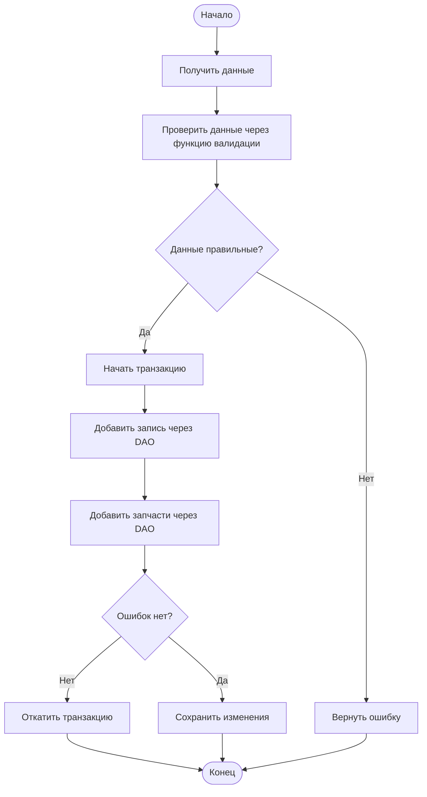
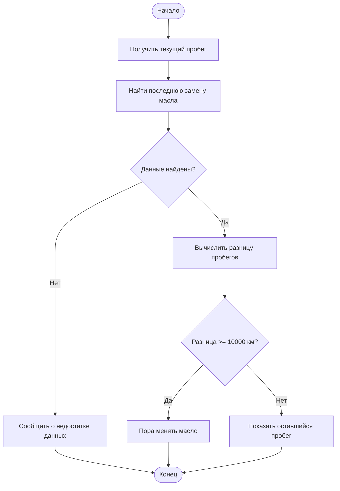

# Задание 5

# Проектирование слоя бизнес-логики CarTrack

## 1. Обзор слоя бизнес-логики

Слой бизнес-логики отвечает за обработку действий пользователя перед обращением к базе данных. Он проверяет введённые данные, выполняет расчёты и контролирует сохранение информации.

В CarTrack предусмотрены четыре основные операции: просмотр истории обслуживания, добавление записи, подсчёт расходов и напоминание о замене масла.

## 2. Описание бизнес-операций

### 2.1. Проверка данных перед добавлением обслуживания

**Функция:** `validate_service_data()`

**Назначение:** проверить данные перед сохранением записи об обслуживании.

**Входные данные:** ID автомобиля, дата, пробег, описание работ, стоимость, список запчастей.

**Результат:** подтверждение правильности данных или сообщение об ошибке.

**Используемые операции DAO:** получение автомобиля по ID.

**Алгоритм (псевдокод):**

```text
НАЧАЛО
Получить данные обслуживания
Проверить существование автомобиля
Проверить наличие даты и описания
Проверить, что пробег и стоимость не отрицательные
Проверить количество и цену запчастей

ЕСЛИ данные неправильные
    Вернуть сообщение об ошибке
ИНАЧЕ
    Вернуть результат проверки
КОНЕЦ
```

**Проверки и ошибки:**
- Автомобиль должен существовать в базе.
- Дата и описание обязательны.
- Пробег и стоимость не могут быть отрицательными.
- Количество запчастей должно быть больше нуля.
- При неправильных данных запись не сохраняется.

**Тест-кейсы:**

| № | Входные данные | Ожидаемое поведение | Ожидаемый результат |
|---|---|---|---|
| 1 | Все поля заполнены правильно | Проверка данных | Данные приняты |
| 2 | Отрицательный пробег | Проверка пробега | Ошибка, данные отклонены |
| 3 | Несуществующий ID автомобиля | Проверка автомобиля через DAO | Сообщение об ошибке |

### 2.2. Добавление записи об обслуживании

**Функция:** `add_service_record()`

**Назначение:** сохранить новую запись об обслуживании автомобиля вместе с использованными запчастями.

**Входные данные:** ID автомобиля, дата, пробег, описание работ, стоимость и список запчастей.

**Результат:** сохранённая запись или сообщение об ошибке.

**Используемые операции DAO:**
- Получение автомобиля по ID.
- Добавление записи в `service_records`.
- Добавление запчастей в `parts`.

**SQL-запросы DAO:**

```sql
INSERT INTO service_records
(car_id, date, mileage, description, cost)
VALUES (?, ?, ?, ?, ?);
```

```sql
INSERT INTO parts
(service_record_id, name, quantity, price)
VALUES (?, ?, ?, ?);
```

**Алгоритм (псевдокод):**

```text
НАЧАЛО
Получить данные обслуживания
Вызвать validate_service_data()

ЕСЛИ проверка не пройдена
    Вернуть ошибку
ИНАЧЕ
    Начать транзакцию
    Добавить запись обслуживания через DAO
    Получить ID новой записи
    Добавить запчасти через DAO

    ЕСЛИ произошла ошибка
        Отменить транзакцию
        Вернуть ошибку
    ИНАЧЕ
        Сохранить изменения
        Вернуть успешный результат
КОНЕЦ
```

**Проверки и ошибки:**
- Все обязательные поля должны быть заполнены.
- Пробег и стоимость не могут быть отрицательными.
- Количество запчастей должно быть больше нуля.
- Если при добавлении запчастей произошла ошибка, транзакция отменяется.
- При сбое базы данных запись не должна сохраняться частично.

**Тест-кейсы:**

| № | Входные данные | Ожидаемое поведение | Ожидаемый результат |
|---|---|---|---|
| 1 | Корректная запись и запчасти | Сохранение через DAO | Запись и запчасти добавлены |
| 2 | Пустое описание | Проверка данных | Запись не добавлена |
| 3 | Ошибка при добавлении запчасти | Откат транзакции | Данные не сохранены частично |

### 2.3. Подсчёт общих расходов

**Функция:** `calculate_total_expenses()`

**Назначение:** определить общую сумму расходов на обслуживание выбранного автомобиля.

**Входные данные:** ID автомобиля.

**Результат:** общая сумма расходов на работы и запчасти.

**Используемые операции DAO:**
- Получение автомобиля по ID.
- Получение суммы стоимости работ.
- Получение суммы стоимости запчастей.

**SQL-запросы DAO:**

Стоимость работ:

```sql
SELECT COALESCE(SUM(cost), 0)
FROM service_records
WHERE car_id = ?;
```

Стоимость запчастей:

```sql
SELECT COALESCE(SUM(p.quantity * p.price), 0)
FROM parts p
JOIN service_records sr
ON p.service_record_id = sr.id
WHERE sr.car_id = ?;
```

**Алгоритм (псевдокод):**

```text
НАЧАЛО
Получить ID автомобиля
Проверить существование автомобиля через DAO

ЕСЛИ автомобиль не найден
    Вернуть ошибку
ИНАЧЕ
    Получить сумму работ через DAO
    Получить сумму запчастей через DAO
    Сложить полученные суммы
    Вернуть общую сумму
КОНЕЦ
```

**Проверки и ошибки:**
- Автомобиль должен существовать.
- Если записей обслуживания нет, расходы равны нулю.
- Если база данных недоступна, расчёт прекращается.
- При ошибке нельзя показывать неправильную сумму.

**Тест-кейсы:**

| № | Входные данные | Ожидаемое поведение | Ожидаемый результат |
|---|---|---|---|
| 1 | Работы 2000 руб., две запчасти по 500 руб. | Сложение расходов | 3000 руб. |
| 2 | Несуществующий ID автомобиля | Проверка автомобиля | Сообщение об ошибке |
| 3 | Автомобиль без записей обслуживания | Расчёт пустой истории | 0 руб. |

### 2.4. Проверка необходимости замены масла

**Функция:** `check_oil_reminder()`

**Назначение:** определить, пора ли менять масло в автомобиле.

**Входные данные:** ID автомобиля.

**Результат:** сообщение о необходимости замены масла или оставшемся пробеге.

**Используемые операции DAO:**
- Получение максимального пробега автомобиля.
- Получение последней записи о замене масла.

**SQL-запросы DAO:**

Получение текущего пробега:

```sql
SELECT MAX(mileage)
FROM service_records
WHERE car_id = ?;
```

Поиск последней замены масла:

```sql
SELECT mileage
FROM service_records
WHERE car_id = ?
AND LOWER(description) LIKE '%масл%'
ORDER BY mileage DESC
LIMIT 1;
```

**Алгоритм (псевдокод):**

```text
НАЧАЛО
Получить текущий пробег через DAO
Найти последнюю замену масла через DAO

ЕСЛИ данные отсутствуют
    Вернуть сообщение о недостатке данных
ИНАЧЕ
    Вычислить разницу пробегов

    ЕСЛИ разница >= 10000
        Сообщить о необходимости замены масла
    ИНАЧЕ
        Показать оставшийся пробег
КОНЕЦ
```

**Проверки и ошибки:**
- Автомобиль должен существовать.
- Должна быть запись с пробегом.
- Должна быть запись о замене масла.
- При ошибке БД расчёт не выполняется.
- Замена масла определяется по описанию работ, так как отдельного поля для неё в базе нет.

**Тест-кейсы:**

| № | Входные данные | Ожидаемое поведение | Ожидаемый результат |
|---|---|---|---|
| 1 | Текущий пробег 25000 км, замена на 14000 км | Расчёт разницы | Пора менять масло |
| 2 | Текущий пробег 20000 км, замена на 15000 км | Расчёт остатка | Осталось 5000 км |
| 3 | Нет записи о замене масла | Проверка истории | Недостаточно данных |

## 3. Блок-схемы

### 3.1. Добавление записи обслуживания



### 3.2. Проверка замены масла



## 4. Тест-кейсы

| № | Операция | Входные данные | Ожидаемое поведение | Результат |
|---|---|---|---|---|
| 1 | Просмотр истории | Существующий автомобиль | Загрузка записей | История отображается |
| 2 | Просмотр истории | Несуществующий ID | Проверка автомобиля | Сообщение об ошибке |
| 3 | Просмотр истории | Автомобиль без записей | Проверка истории | История пуста |
| 4 | Добавление записи | Корректные данные | Сохранение записи | Запись добавлена |
| 5 | Добавление записи | Отрицательный пробег | Проверка данных | Запись не добавлена |
| 6 | Добавление записи | Ошибка БД при сохранении запчастей | Отмена транзакции | Данные не сохранены частично |
| 7 | Подсчёт расходов | Работа 2000 руб., две запчасти по 500 руб. | Сложение расходов | 3000 руб. |
| 8 | Подсчёт расходов | Нет записей | Расчёт пустой истории | 0 руб. |
| 9 | Подсчёт расходов | База данных недоступна | Остановка расчёта | Сообщение об ошибке |
| 10 | Напоминание о масле | Пробег 25000 км, замена на 14000 км | Сравнение пробегов | Пора менять масло |
| 11 | Напоминание о масле | Пробег 20000 км, замена на 15000 км | Расчёт остатка | Осталось 5000 км |
| 12 | Напоминание о масле | Нет записи о замене | Проверка истории | Недостаточно данных |
