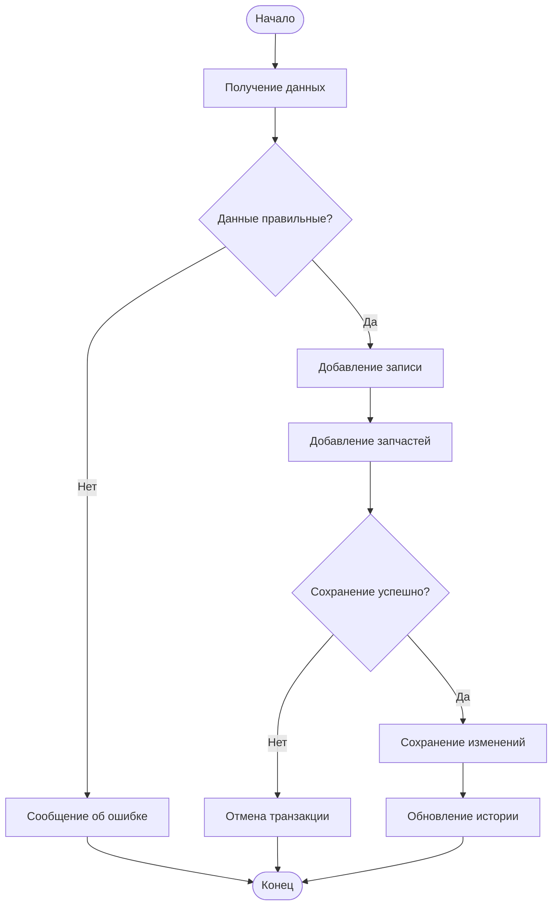
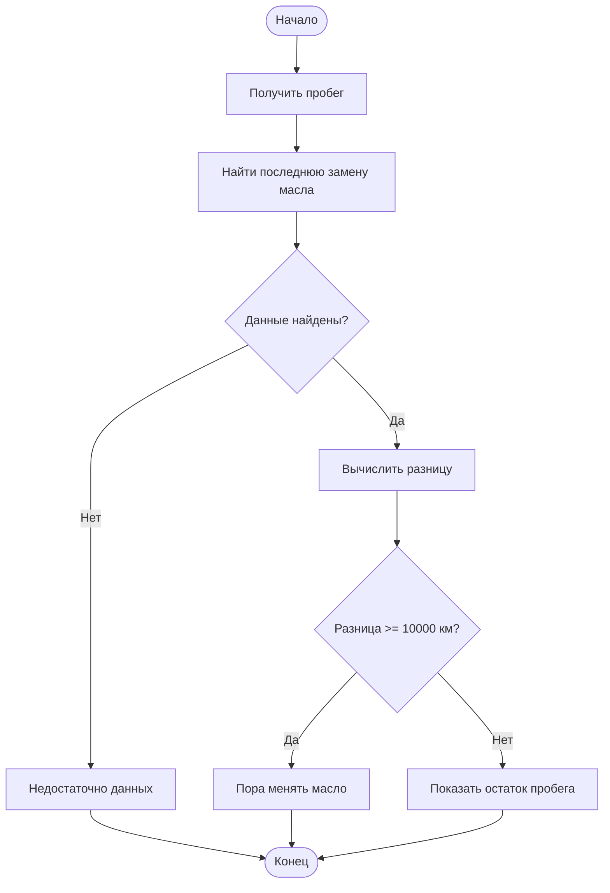

# Задание 5

# Проектирование слоя бизнес-логики CarTrack

## 1. Обзор слоя бизнес-логики

Слой бизнес-логики отвечает за обработку действий пользователя перед обращением к базе данных. Он проверяет введённые данные, выполняет расчёты и контролирует сохранение информации.

В CarTrack предусмотрены четыре основные операции: просмотр истории обслуживания, добавление записи, подсчёт расходов и напоминание о замене масла.

## 2. Описание бизнес-операций

### 2.1. Просмотр истории обслуживания

**Назначение:** показать историю обслуживания выбранного автомобиля.

**Входные данные:** ID автомобиля (`car_id`).

**Результат:** список записей об обслуживании и информация о расходах.

**SQL-запросы:**
```sql
SELECT id, name FROM cars WHERE id = ?;

SELECT id, date, mileage, description, cost
FROM service_records
WHERE car_id = ?
ORDER BY date DESC;

SELECT name, quantity, price
FROM parts
WHERE service_record_id = ?;
```

**Алгоритм:**
1. Получить ID выбранного автомобиля.
2. Проверить наличие автомобиля в базе.
3. Получить все записи обслуживания.
4. Получить связанные с ними запчасти.
5. Вывести историю на экран.

**Проверки и ошибки:** если автомобиля нет в базе, вывести сообщение об ошибке. Если история пустая, показать соответствующее сообщение. При сбое БД прекратить выполнение операции.

### 2.2. Добавление записи об обслуживании

**Назначение:** добавить информацию о ремонте или техническом обслуживании.

**Входные данные:** автомобиль, дата, пробег, описание работ, стоимость и информация о запчастях.

**Результат:** новая запись в истории обслуживания.

**SQL-запросы:**
```sql
INSERT INTO service_records
(car_id, date, mileage, description, cost)
VALUES (?, ?, ?, ?, ?);

INSERT INTO parts
(service_record_id, name, quantity, price)
VALUES (?, ?, ?, ?);
```

**Алгоритм:**
1. Получить данные из формы.
2. Проверить правильность заполнения.
3. Добавить запись в `service_records`.
4. Получить ID созданной записи.
5. Добавить запчасти в `parts`.
6. Сохранить изменения.
7. Обновить историю обслуживания.

**Проверки и ошибки:** пробег и стоимость не могут быть отрицательными, описание и дата обязательны. Количество запчастей должно быть больше нуля. При ошибке сохранения отменить транзакцию, чтобы данные не записались частично.

### 2.3. Подсчёт общих расходов

**Назначение:** рассчитать, сколько денег потрачено на обслуживание автомобиля.

**Входные данные:** ID автомобиля.

**Результат:** общая сумма расходов на работы и запчасти.

**SQL-запрос:**
```sql
SELECT
    COALESCE(SUM(sr.cost), 0) AS work_total,
    COALESCE(SUM(
        (SELECT SUM(p.quantity * p.price)
         FROM parts p
         WHERE p.service_record_id = sr.id)
    ), 0) AS parts_total
FROM service_records sr
WHERE sr.car_id = ?;
```

**Алгоритм:**
1. Получить записи выбранного автомобиля.
2. Посчитать стоимость всех работ.
3. Посчитать стоимость запчастей.
4. Сложить полученные суммы.
5. Вывести общий расход.

**Проверки и ошибки:** автомобиль должен существовать. Если записей нет, расходы равны нулю. При ошибке БД вывести сообщение и не показывать неправильную сумму.

### 2.4. Напоминание о замене масла

**Назначение:** определить, когда автомобилю потребуется следующая замена масла.

**Входные данные:** ID автомобиля и пробег из истории обслуживания.

**Результат:** сообщение о необходимости замены масла или количестве оставшихся километров.

**SQL-запросы:**
```sql
SELECT MAX(mileage)
FROM service_records
WHERE car_id = ?;
```

```sql
SELECT mileage
FROM service_records
WHERE car_id = ?
AND LOWER(description) LIKE '%масл%'
ORDER BY mileage DESC
LIMIT 1;
```

**Алгоритм:**
1. Получить максимальный пробег автомобиля.
2. Найти последнюю запись о замене масла.
3. Получить пробег на момент последней замены.
4. Вычислить разницу между пробегами.
5. Если разница составляет 10 000 км или больше, вывести напоминание.
6. Иначе показать оставшийся пробег до замены.

**Проверки и ошибки:** если нет записей о пробеге или замене масла, вывести сообщение о недостатке данных. Если произошла ошибка БД, не выполнять расчёт.

*Примечание: в текущей версии CarTrack замена масла определяется по описанию работ, так как отдельного поля для этого в базе данных нет.*

## 3. Блок-схемы

### 3.1. Добавление записи обслуживания



### 3.2. Проверка замены масла



## 4. Тест-кейсы

| № | Операция | Входные данные | Ожидаемое поведение | Результат |
|---|---|---|---|---|
| 1 | Просмотр истории | Существующий автомобиль | Загрузка записей | История отображается |
| 2 | Просмотр истории | Несуществующий ID | Проверка автомобиля | Сообщение об ошибке |
| 3 | Просмотр истории | Автомобиль без записей | Проверка истории | История пуста |
| 4 | Добавление записи | Корректные данные | Сохранение записи | Запись добавлена |
| 5 | Добавление записи | Отрицательный пробег | Проверка данных | Запись не добавлена |
| 6 | Добавление записи | Ошибка БД при сохранении запчастей | Отмена транзакции | Данные не сохранены частично |
| 7 | Подсчёт расходов | Работа 2000 руб., две запчасти по 500 руб. | Сложение расходов | 3000 руб. |
| 8 | Подсчёт расходов | Нет записей | Расчёт пустой истории | 0 руб. |
| 9 | Подсчёт расходов | База данных недоступна | Остановка расчёта | Сообщение об ошибке |
| 10 | Напоминание о масле | Пробег 25000 км, замена на 14000 км | Сравнение пробегов | Пора менять масло |
| 11 | Напоминание о масле | Пробег 20000 км, замена на 15000 км | Расчёт остатка | Осталось 5000 км |
| 12 | Напоминание о масле | Нет записи о замене | Проверка истории | Недостаточно данных |
