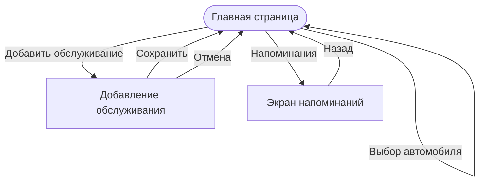

# Задание 6

# Проектирование пользовательского интерфейса CarTrack

## 1. Список экранов приложения

В CarTrack предусмотрено три основных экрана:

1. Главная страница.
2. Добавление записи об обслуживании.
3. Напоминания о замене масла.

## 2. Описание экранов

### 2.1. Главная страница

**Назначение:** просмотр информации об автомобиле и его обслуживании.

**Элементы управления:**
- Список выбора автомобиля.
- Кнопка «Добавить обслуживание».
- Кнопка «Напоминания».
- Таблица истории обслуживания.

**Отображаемые данные:**
- Название выбранного автомобиля.
- Дата обслуживания.
- Пробег.
- Описание выполненных работ.
- Стоимость.
- Общая сумма расходов.

Данные загружаются из таблиц `cars`, `service_records` и `parts`.

**Действия пользователя:**
- Выбрать автомобиль.
- Просмотреть историю обслуживания.
- Перейти к добавлению новой записи.
- Открыть напоминания.

**Реакция системы:**
- После выбора автомобиля обновляется история и сумма расходов.
- При нажатии «Добавить обслуживание» открывается форма.
- При нажатии «Напоминания» открывается экран напоминаний.

**Обработка ошибок:** если история отсутствует, выводится сообщение «История обслуживания пуста». Если данные не удалось загрузить, появляется сообщение об ошибке.

### 2.2. Экран добавления обслуживания

**Назначение:** внесение информации о ремонте или техническом обслуживании автомобиля.

**Элементы управления:**
- Поле «Дата».
- Поле «Пробег».
- Поле «Описание работ».
- Поле «Стоимость».
- Поля для добавления запчастей: название, количество и цена.
- Кнопка «Сохранить».
- Кнопка «Отмена».

**Отображаемые данные:** выбранный автомобиль и введённые пользователем данные.

**Действия пользователя:**
- Заполнить информацию об обслуживании.
- При необходимости добавить запчасти.
- Сохранить запись или отменить действие.

**Реакция системы:**
- При нажатии «Сохранить» система проверяет введённые данные.
- Если всё заполнено правильно, запись сохраняется в базе данных.
- После сохранения пользователь возвращается на главную страницу.
- При отмене форма закрывается без сохранения.

**Обработка ошибок:** если не заполнены обязательные поля или введены отрицательные значения, система показывает сообщение об ошибке и не сохраняет запись.

### 2.3. Экран напоминаний

**Назначение:** просмотр информации о необходимости замены масла.

**Элементы управления:**
- Кнопка возврата на главную страницу.
- Информационный блок с напоминанием.

**Отображаемые данные:**
- Текущий пробег автомобиля.
- Пробег последней замены масла.
- Количество километров до следующей замены или предупреждение.

Данные берутся из истории обслуживания.

**Действия пользователя:**
- Просмотреть напоминание.
- Вернуться на главную страницу.

**Реакция системы:**
- Если после последней замены прошло 10 000 км или больше, появляется сообщение «Пора менять масло!».
- Если пробег меньше, показывается оставшееся расстояние.
- При возврате открывается главная страница.

**Обработка ошибок:** если информации о замене масла нет, выводится сообщение «Недостаточно данных для расчёта».

## 3. Схема переходов между экранами

## 4. Сценарии взаимодействия

### Сценарий 1. Просмотр истории автомобиля

1. Пользователь открывает главную страницу.
2. Выбирает автомобиль из списка.
3. Система загружает его историю обслуживания.
4. На экране отображаются даты, пробег, описание работ и стоимость.
5. Пользователь видит общую сумму расходов.

### Сценарий 2. Добавление обслуживания

1. Пользователь открывает главную страницу.
2. Выбирает автомобиль.
3. Нажимает «Добавить обслуживание».
4. Открывается форма добавления записи.
5. Пользователь вводит дату, пробег, описание работ и стоимость.
6. При необходимости указывает запчасти.
7. Нажимает «Сохранить».
8. Система проверяет данные и сохраняет запись.
9. Пользователь возвращается на главную страницу, где отображается новая запись.

### Сценарий 3. Проверка напоминания о замене масла

1. Пользователь открывает главную страницу.
2. Выбирает нужный автомобиль.
3. Нажимает «Напоминания».
4. Система получает данные из истории обслуживания.
5. Проверяет пробег последней замены масла и текущий пробег.
6. Показывает предупреждение или количество оставшихся километров.
7. Пользователь возвращается на главную страницу.

## 5. Итог

В результате были определены основные экраны CarTrack, их элементы управления и действия пользователя. Также описаны переходы между экранами и три основных сценария работы приложения.
